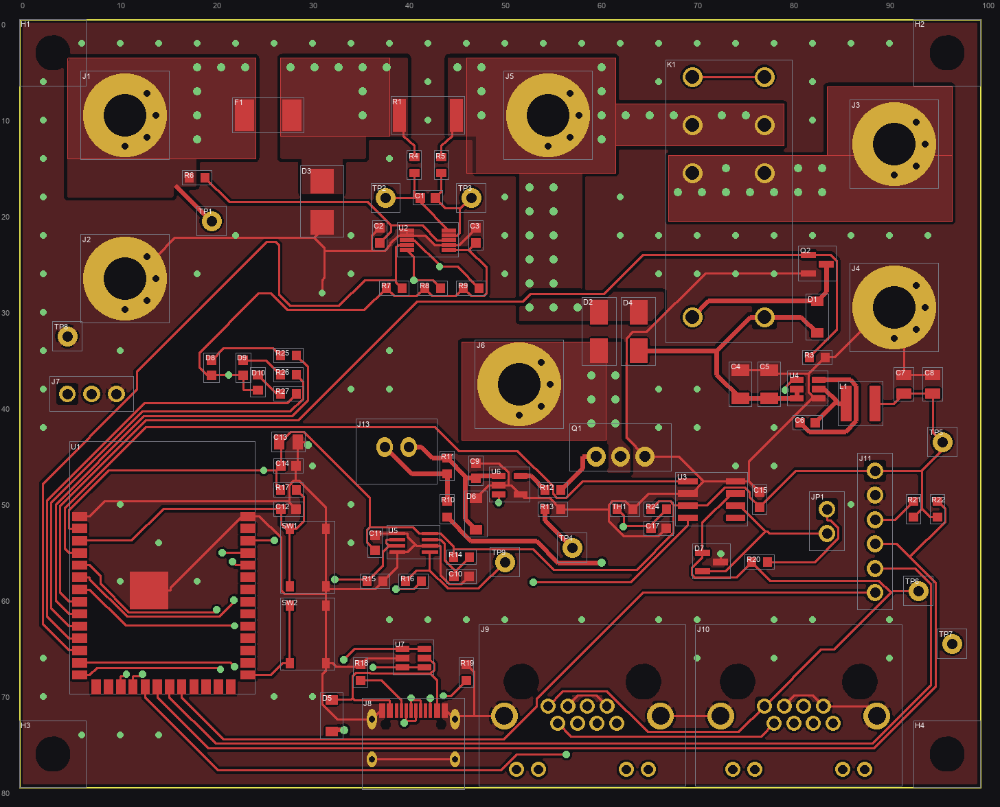
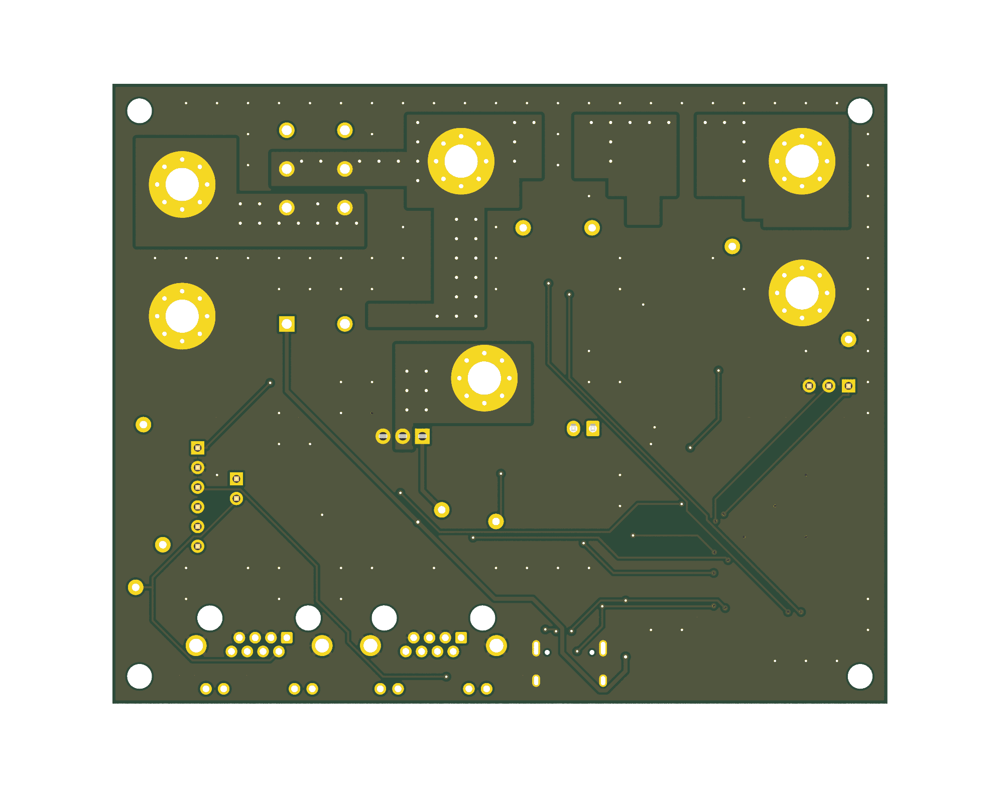
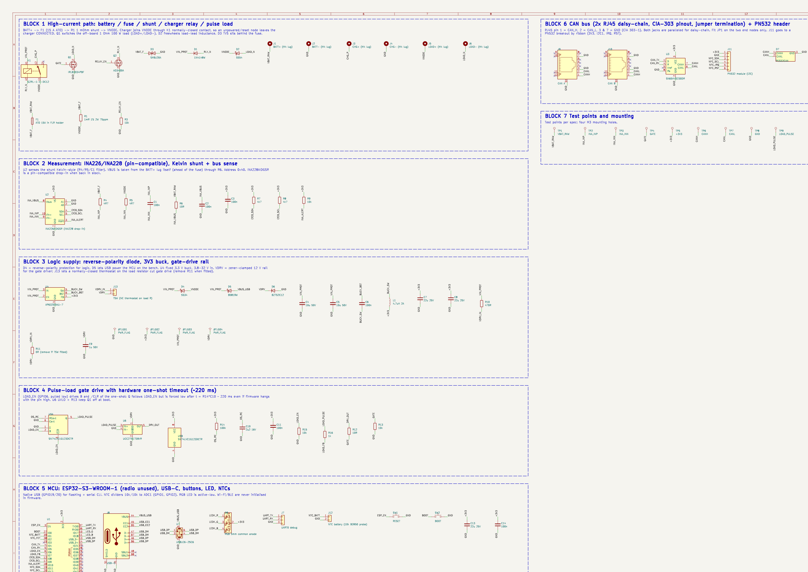

# FRC Battery IR Monitor Node — hardware rev A

An inline node that sits between a charger and a 12 V FRC battery (charger → node → battery).
It measures internal resistance with a 12 A / 100 ms pulse
load, and reports to a pit hub over wired CAN. No Wi-Fi or Bluetooth is used.


**Status:** schematic and layout are complete (ERC and DRC clean) and ready to order. Node
firmware, the Raspberry Pi hub software and printable cases are included. Nothing has been built
or tested on real hardware yet: the firmware compiles and the hub passes a simulated-node test.

- **[docs/BOM.md](docs/BOM.md): everything to buy, with purchase links.**
- **[docs/setup.md](docs/setup.md): full shopping list (including the Pi and CAN HAT), assembly,
  flashing, hub install, CAN wiring.** Start here.
- [docs/design.md](docs/design.md): calculations, parts that differ from the original brief, open questions.

## Board at a glance

- 100 × 80 mm, 2 layers, 2 oz copper, four M3 mounting holes
- ESP32-S3 (radio unused), INA226 current/voltage monitor with a 1 mΩ Kelvin-sensed shunt
- Charger relay on its normally-closed contact, so an unpowered node leaves the charger connected
- Pulse-load MOSFET with a hardware one-shot that cuts the load after ~220 ms even if firmware hangs
- Two RJ45 jacks for daisy-chained CAN, USB-C for flashing and serial
- Six M4 bolt-down lug pads: BATT±, CHG±, LOAD± (off-board 1 Ω 100 W resistor)

| Top copper | Bottom copper |
|---|---|
|  |  |

| Component placement | Underside (3D) |
|---|---|
|  |  |

Full schematic: [hw/ir_node_schematic.pdf](hw/ir_node_schematic.pdf). The image below is a partial
view (the sheet is cropped at the right and bottom).



## Repository layout

| Folder | Contents |
|---|---|
| `docs/design.md` | Phase 1 design document: deviations, part choices, calculations, accuracy budget, open questions |
| `hw/` | KiCad 9 project: `ir_node.kicad_pro`, `.kicad_sch`, `.kicad_pcb`, schematic PDF, ERC and DRC reports |
| `fab/` | `ir_node_gerbers.zip` (Gerbers + drill), `ir_node_BOM_JLC.csv`, `ir_node_CPL_JLC.csv`, `ir_node_BOM_full.csv` |
| `renders/` | PNG previews of each copper layer and 3D views |
| `firmware/` | ESP32-S3 node firmware (PlatformIO, Arduino framework) |
| `hub/` | Raspberry Pi hub: CAN logger, SQLite history, web page, installer, simulated node and test |
| `case/` | Printable STLs: node base and lid, Pi tray |
| `tools/` | The Python scripts that generate everything (run with KiCad's bundled Python) |

## Ordering (JLCPCB)

1. Upload `fab/ir_node_gerbers.zip`. Options: 2 layers, 1.6 mm, **2 oz outer copper**, 100 × 80 mm.
   To save money on rev A you can order **1 oz** instead: the pours are wide enough for the 12 A
   pulse and for chargers up to about 10 A. Stay with 2 oz if your charger is larger.
2. Enable PCB assembly, top side. Upload `ir_node_BOM_JLC.csv` and `ir_node_CPL_JLC.csv`.
3. **Check every part's orientation in JLC's placement preview** before paying — rotation
   conventions differ between KiCad and JLC for some packages (SOT-23, diodes, the ESP32 module).
4. Hand-solder the through-hole parts listed as "hand-solder / THT" in `ir_node_BOM_full.csv`.

PCBWay or any other fab can use the same Gerber zip; give them `ir_node_BOM_full.csv`, which has
manufacturer part numbers as well as LCSC numbers.

## What else you need

The PCB is one part of the system. The complete list with quantities, notes and rough prices is
in [docs/setup.md](docs/setup.md#1-everything-to-buy). In short:

- **Per node:** 1 Ω 100 W resistor, two SB50 connectors, 10 and 14 AWG wire, M4 ring terminals and hardware,
  an Ethernet patch cable, four M3 × 16 screws, printed case
- **Hub (one per pit):** Raspberry Pi (3B+, 4 or 5), MCP2515 CAN HAT, microSD card, Pi power
  supply, one patch cable cut in half, printed tray

## Cases


## Regenerating

```
python tools/gen_sch.py     # schematic from tools/design.py
python tools/route.py <freerouting.jar>   # place, autoroute, pour
python tools/gen_fab.py     # BOM, CPL, Gerbers, renders
python tools/gen_case.py    # case STLs (needs: pip install manifold3d numpy pillow matplotlib)
python hub/test_hub.py      # hub against a simulated node (needs: pip install python-can)
```
