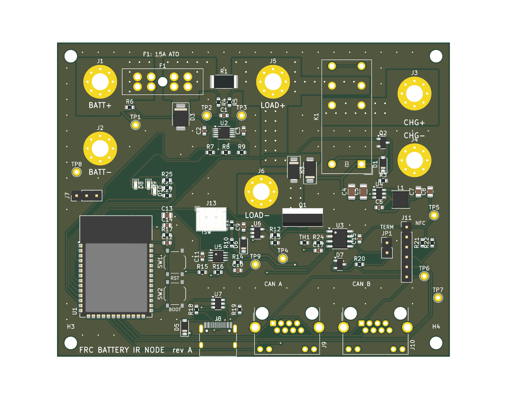
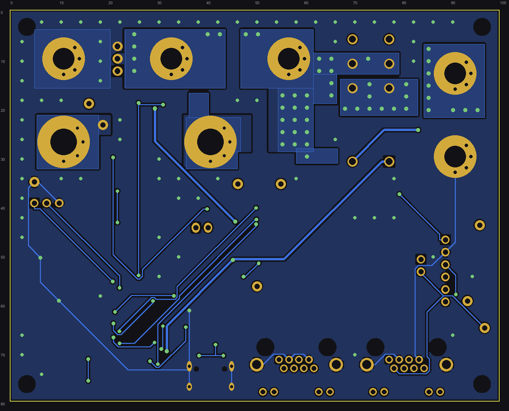

# FRC Battery IR Monitor Node — hardware rev B (120 A pulse)

An inline node that sits between a charger and a 12 V FRC battery (charger → node → battery).
It measures internal resistance with a ~110 A / 100 ms pulse
load, and reports to a pit hub over wired CAN. No Wi-Fi or Bluetooth is used.



**Status:** schematic and layout are complete (ERC and DRC clean) and ready to order. Node
firmware, the Raspberry Pi hub software and printable cases are included. Nothing has been built
or tested on real hardware yet: the firmware compiles and the hub passes a simulated-node test.

- **[docs/BOM.md](docs/BOM.md): everything to buy, with purchase links.**
- **[docs/setup.md](docs/setup.md): full shopping list (including the Pi and CAN HAT), assembly,
  flashing, hub install, CAN wiring.** Start here.
- [docs/rev_b_120A.md](docs/rev_b_120A.md): what rev B changes from rev A (the `main` branch), its
  calculations, and what to check before the first pulse.
- [docs/design.md](docs/design.md): rev A calculations, parts that differ from the original brief, open questions.

## Board at a glance

- 100 × 80 mm, 2 layers, 2 oz copper, four #10 mounting holes (0.196 in)
- ESP32-S3 (radio unused), INA226 current/voltage monitor with a 0.5 mΩ Kelvin-sensed shunt
- Charger relay on its normally-closed contact, so an unpowered node leaves the charger connected, with its own 10 A fuse
- Pulse-load MOSFET with a hardware one-shot that cuts the load after ~220 ms even if firmware hangs
- Two RJ45 jacks for daisy-chained CAN, USB-C for flashing and serial, JST-XH socket for an optional PN532 NFC reader
- Bolt-down lug pads for BATT±, CHG±, LOAD± (off-board 0.1 Ω load bank) and two M5 studs that carry a 60 A MIDI fuse

| Top copper | Bottom copper |
|---|---|
|  |  |

| Component placement | Underside (3D) |
|---|---|
|  |  |

Full schematic: [hw/ir_node_schematic.pdf](hw/ir_node_schematic.pdf).

## Repository layout

| Folder | Contents |
|---|---|
| `docs/design.md` | Phase 1 design document: deviations, part choices, calculations, accuracy budget, open questions |
| `hw/` | KiCad 9 project: `ir_node.kicad_pro`, `.kicad_sch`, `.kicad_pcb`, schematic PDF, ERC and DRC reports |
| `fab/` | `ir_node_gerbers.zip` (Gerbers + drill), `pcbway/` (PCBWay BOM and placement file), `ir_node_BOM_full.csv`, JLCPCB BOM and CPL |
| `renders/` | PNG previews of each copper layer and 3D views |
| `firmware/` | ESP32-S3 node firmware (PlatformIO, Arduino framework) |
| `hub/` | Raspberry Pi hub: CAN logger, SQLite history, web page, installer, simulated node and test |
| `case/` | Printable STLs: node base and lid, Pi tray, optional NFC reader holder |
| `tools/` | The Python scripts that generate everything (run with KiCad's bundled Python) |

## Ordering (PCBWay)

1. PCB: upload `fab/ir_node_gerbers.zip`. Options: 2 layers, 100 × 80 mm, 1.6 mm FR-4,
   **2 oz finished copper**, HASL lead-free or ENIG. Minimum track/space on the board is 0.25/0.20 mm
   and the smallest via is 0.3 mm drill in a 0.7 mm pad.
2. Assembly: turnkey, top side only, 67 SMD placements of 42 part types. Upload
   `fab/pcbway/ir_node_BOM_PCBWay.csv` and `fab/pcbway/ir_node_CPL_PCBWay.csv`.
   To have PCBWay also fit the through-hole parts (relay, MOSFET, RJ45 ×2, JST-XH ×2, headers),
   upload `ir_node_BOM_PCBWay_with_THT.csv` instead and say so in the order notes.
3. The BOM lists a manufacturer part number for every line, the LCSC number as a sourcing
   reference, and which lines may be substituted. PCBWay emails about anything it wants to swap:
   passives, diodes and LEDs are free to swap like for like; the ICs, shunt R1, inductor L1, USB-C
   socket and buttons are not.
4. The placement file uses KiCad's own rotations and coordinates (no fab-specific offsets). Pin 1
   and polarity are marked on the silkscreen; `fab/layers_pdf/ir_node-F_Fab.pdf` is the assembly drawing.
5. If you did not order through-hole assembly, hand-solder the "THT" rows of
   `ir_node_BOM_PCBWay_with_THT.csv`.

The JLCPCB files (`ir_node_BOM_JLC.csv`, `ir_node_CPL_JLC.csv`, which carry JLC's rotation offsets)
are still generated for reference.

## What else you need

The PCB is one part of the system. The complete list with quantities, notes and rough prices is
in [docs/setup.md](docs/setup.md#1-everything-to-buy). In short:

- **Per node:** two 0.2 Ω 100 W resistors, normally-closed thermostat, 60 A MIDI fuse, two SB50 connectors, 6, 8 and 10 AWG wire, ring terminals, M4 and M5 hardware,
  an Ethernet patch cable, four #10-32 × 5/8 in screws, printed case
- **Hub (one per pit):** Raspberry Pi (3B+, 4 or 5), MCP2515 CAN HAT, microSD card, Pi power
  supply, one patch cable cut in half, printed tray

## Cases


## Regenerating

```
python tools/gen_sch.py     # schematic from tools/design.py
python tools/route.py <freerouting.jar>   # place, autoroute, pour
python tools/gen_fab.py     # BOM, CPL, Gerbers, renders
python tools/gen_case.py    # case STLs (needs: pip install manifold3d numpy pillow matplotlib)
python hub/test_hub.py      # hub against a simulated node (needs: pip install python-can)
```
