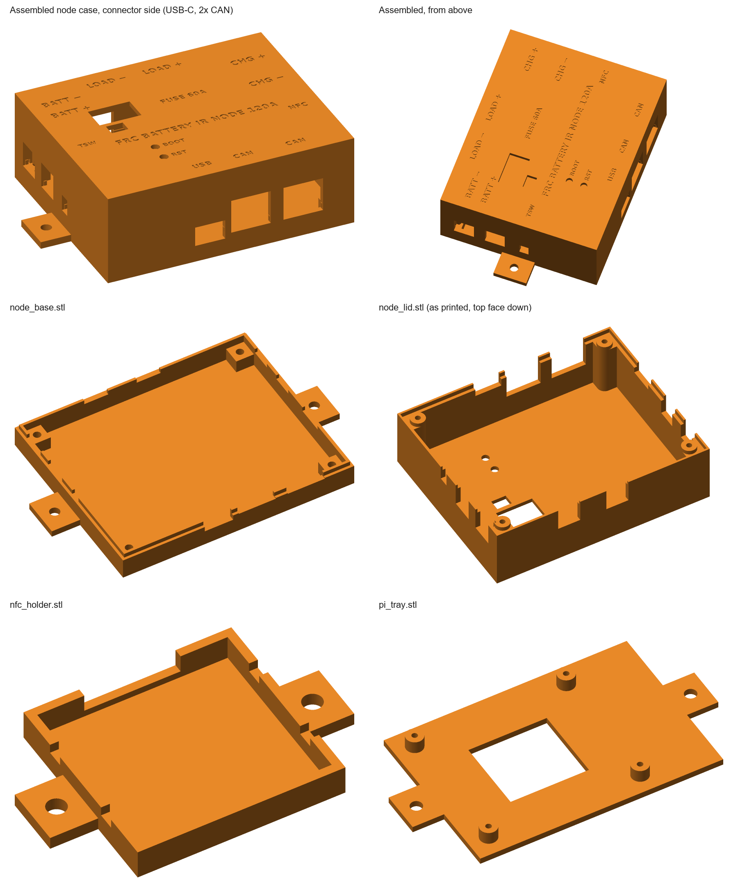

# Setup guide: from boxes of parts to a working pit system

**This is the rev B (120 A pulse) branch.** What changed from rev A and why is in
[rev_b_120A.md](rev_b_120A.md); read its "Check before trusting it" list before the first pulse.

Nothing here has been run on real hardware yet. The firmware compiles and the hub passes its
simulated-node test, but expect some bring-up debugging on the first board.

The system is: one **node** per charger (the PCB in this repo, in its printed case), and one
**hub** (a Raspberry Pi with a CAN HAT) that logs results and serves a web page. Nodes and hub
are chained together with ordinary Ethernet patch cables carrying CAN.

```
 charger ──SB50──┐                       ┌──SB50── battery
                 │  CHG±           BATT± │
              ┌──┴───────── node ────────┴──┐
              │  LOAD± ── load bank: 2 × 0.2 Ω 100 W in parallel
              └── CAN (RJ45) ── next node ── … ── Raspberry Pi + CAN HAT
```

## 1. Everything to buy

Prices are rough single-quantity figures from typical hobby suppliers, not quotes.

### Per node (one per charger bay)

| Item | Qty | Notes | ~USD |
|---|---|---|---|
| Assembled PCB from JLCPCB | 1 | `fab/` files; see README for ordering | 30–45 |
| Hand-solder parts for the PCB | 1 set | The "hand-solder / THT" rows in `fab/ir_node_BOM_full.csv`: relay, MOSFET, RJ45 ×2, headers | (in BOM) |
| Bolt-down **MIDI fuse, 60 A**, 32 V or higher (30 mm hole spacing) | 1 | Plus a spare. Bolts across the two M5 studs on the board | 3–5 |
| M5 × 20 bolts, 2 plain nuts + 1 lock nut each, washers | 2 sets | Fuse studs: bolt from below, nut, fuse, (ring terminal on the BATT+ stud), washer, lock nut | 1 |
| Load resistor, **0.2 Ω 100 W**, aluminium-housed | 2 | Wired in parallel (0.1 Ω, about 105 A). Use three 0.25 Ω instead for about 120 A. Bolt them to a metal plate | 12–20 |
| Thermostat, **normally closed**, opens at 70–80 °C (KSD9700 or KSD301 style) | 1 | Required. Bolted or epoxied to the load resistor and plugged into J13; without it the node cannot fire a pulse | 2 |
| JST-XH 2-pin plug with leads | 1 | For the thermostat | 0.50 |
| Anderson SB50 housing + 6 AWG contacts | 1 | Mates the battery | 5 |
| Anderson SB50 housing + 10–12 AWG contacts | 1 | Mates the charger | 4 |
| 6 AWG wire, red and black (8 AWG is acceptable) | ~0.3 m each | Battery pigtail; keep it short | 5 |
| 8 AWG wire | ~0.6 m | Node to load bank and between the resistors | 3 |
| 10–12 AWG wire, red and black | ~0.3 m each | Charger pigtail | 2 |
| Ring terminals: 6 AWG with M5 hole (1), 6 AWG M4 (1), 8 AWG M4 (2 + resistor ends), 10–12 AWG M4 (2) | 1 set | BATT+ goes on the M5 fuse stud; everything else is M4 | 5 |
| M4 × 10 screws, nuts, lock washers | 5 each | Bolt the ring terminals to the PCB pads | 1 |
| M3 × 16 screws | 4 | Case: up through base and PCB into the lid | 0.50 |
| Screws to mount the case and resistor plate | a few | Up to M4 through the case ears | 0.50 |
| Ethernet patch cable (Cat5e or better) | 1 | To the next node or the hub. Length to suit; keep the whole chain under ~50 m | 2 |
| Printed case | 1 | `case/node_base.stl`, `case/node_lid.stl`; ~70 g of PETG | 2 |

### Hub (one for the whole pit)

| Item | Qty | Notes | ~USD |
|---|---|---|---|
| Raspberry Pi 4 Model B (2 GB is plenty); a 3B+ or 5 also works | 1 | Needs the 40-pin header | 45–60 |
| CAN HAT with an **MCP2515** controller, e.g. Waveshare RS485 CAN HAT | 1 | Has a 3.3 V transceiver, screw terminals for CAN_H / CAN_L, and a 120 Ω termination jumper | 14–18 |
| microSD card, 16 GB or larger | 1 | Raspberry Pi OS Lite (64-bit) | 8 |
| Official Raspberry Pi power supply (USB-C 5 V 3 A for a Pi 4) | 1 | The node boards do not power the Pi | 8–10 |
| Ethernet patch cable to cut in half | 1 | Bare end goes into the HAT's screw terminals | 2 |
| M2.5 × 6 screws | 4 | Pi to `case/pi_tray.stl` | 0.50 |
| 2.54 mm jumper cap | 1 | For JP1 on the last node (often supplied with header strips) | 0.10 |

### Tools

Soldering iron, crimper for ring terminals and SB50 contacts, multimeter, USB-C **data** cable,
a computer with [PlatformIO](https://platformio.org/install/cli) for flashing.

## 2. Print the cases

All parts print flat-side-down with no supports, 0.2 mm layers, 3 perimeters, 20–30 % infill.
PETG or ASA is better than PLA near a charger. `node_lid.stl` is already saved upside down.



- The four M3 × 16 screws go in from underneath: through the base, through the PCB's corner
  holes, and self-tap into the lid's corner posts. Don't overtighten.
- Lid openings: a window over the fuse, a window over the three status LEDs, two pin holes for BOOT and
  RESET (press with a paperclip), and wire slots labelled on the lid. The LEDs sit on the board,
  so they are easiest to see from above.
- To change any dimension, edit the parameters at the top of `tools/gen_case.py` and rerun it.
- Do not print a cover for the load resistor. It needs air, and in a fault it gets hot.

## 3. Build a node

1. Solder the through-hole parts onto the JLC-assembled board.
2. Before connecting a battery: plug in USB-C only and flash the firmware (section 4). The
   console should answer `status`.
3. Crimp ring terminals and bolt the wires on. The lid and the PCB silkscreen label every pad:

   | Pads | Goes to | Wire |
   |---|---|---|
   | BATT+ (M5 fuse stud) / BATT− | SB50 that mates the **battery** | 6 AWG, as short as practical |
   | CHG+ / CHG− | SB50 that mates the **charger** | 10–12 AWG |
   | LOAD+ / LOAD− | the load bank (resistors in parallel) | 8 AWG |

   Fuse studs: M5 bolt up from under the board, a plain nut tightened onto the pad, then the
   fuse, then (on the BATT+ stud) the battery ring terminal, washer and lock nut. The nut under
   the fuse is a spacer so the fuse body clears the board.

   Polarity matters. The board has reverse-polarity protection on its own electronics, but a
   reversed battery with a charger attached is still a short through the charger.
4. Bolt the 60 A fuse on last.
5. **Thermostat (required).** Fix it to the body of the load resistor and plug it into J13. It sits in
   series with the MOSFET's gate supply: if the resistor overheats it opens and no pulse can fire.
   With nothing plugged into J13 every test fails with "pulse current too low". R11 next to J13 is
   left unpopulated on purpose; bridging it bypasses the thermostat and is for bench testing only.

## 4. Flash and configure a node

```bash
cd firmware
```
```bash
pio run -t upload
```
```bash
pio device monitor
```

If the upload can't find the board, hold BOOT, tap RESET, release BOOT, and try again.

In the monitor, type `help`. The settings that matter:

| Command | What it does |
|---|---|
| `id 3` | CAN id, 1–31. **Every node needs a different one.** |
| `test` | Run an IR test now |
| `status` | Readings, detected hardware, last result |
| `lead 2.4` | Milliohms to subtract for your pigtail (below) |
| `auto 30` | Retest every N minutes while a battery is connected (0 = only on arrival / on command) |
| `settle 5` | Seconds to rest after disconnecting the charger before the pulse |
| `good 15`, `warn 20` | LED thresholds in mΩ |

**Lead resistance.** The node measures voltage at its own BATT pads, so the pigtail and SB50
contacts between the pads and the battery are included in the reading. Estimate it and enter it
with `lead`: 6 AWG is about 1.3 mΩ per metre (8 AWG: 2.1), both conductors count, plus roughly
0.2 mΩ per SB50 contact. A 30 cm 6 AWG pigtail is about 0.6 m × 1.3 + 0.4 ≈ 1.2 mΩ. If you have a tester you
trust, measure one battery with both and adjust `lead` until they agree.

**LED colours.** There are three LEDs (red, green, blue) side by side; "yellow" is red and
green lit together, "cyan" is green and blue, and so on.

| LED | Meaning |
|---|---|
| Short blue blink | No battery |
| Cyan | Battery present, not tested yet |
| Fast blue blink, then white flash | Charger disconnected and settling, then the pulse |
| Green / yellow / red | Last result: good / marginal / replace |
| Magenta | Last test failed (type `status`, or look at the hub page) |
| Fast red blink | Load current did not stop. Unplug the battery and inspect the MOSFET. |
| Blinks off briefly every 2 s | Charging current is flowing |
| Fast white blink | "Blink LED" pressed on the hub page |

## 5. Set up the hub

1. Write Raspberry Pi OS Lite to the SD card with Raspberry Pi Imager; set a hostname, user and
   your network in its settings, and enable SSH.
2. Fit the CAN HAT. Look at the crystal next to the MCP2515 chip: it is marked 12.000 or 8.000.
3. Copy the `hub/` folder to the Pi and run the installer with that crystal frequency:

   ```bash
   sudo ./install.sh 12000000
   ```
   ```bash
   sudo reboot
   ```
4. After the reboot, open `http://<pi-hostname>.local:8080` from a phone or laptop on the same
   network. The page has no login; keep the Pi on a network you control.

To try the hub before any node exists, see the top of `hub/sim_node.py`.

## 6. Wire the CAN bus

- Chain the nodes with patch cables: either RJ45 jack on a node works for in or out.
- Cut one patch cable in half for the hub end. With the usual T568B colours:

  | RJ45 pin | Colour (T568B) | Signal | HAT terminal |
  |---|---|---|---|
  | 1 | white/orange | CAN_H | H |
  | 2 | orange | CAN_L | L |
  | 3 | white/green | GND | GND (or Pi header pin 6 if the HAT has no GND terminal) |

  Check with a multimeter against the plug if your cable's colours differ.
- **Terminate both ends and nothing in between.** With the hub at one end: enable the HAT's
  120 Ω jumper, and fit the JP1 jumper cap on the node farthest from the hub. With the power
  off, CAN_H to CAN_L should measure about 60 Ω.
- The cable's ground wire ties every node's battery negative together. That is intended and
  harmless with normal isolated chargers.

## 7. Using it

1. Each node is a station, shown by its CAN id. After a station's first test it appears in the
   history table, where Rename gives it a name (for example the charger bay it sits on).
2. A test runs 5 seconds after a battery arrives, then every `auto` minutes, and whenever you
   press "Test now". Each test opens the charger relay, rests, pulls about 110 A for 0.1 s, and
   reconnects the charger.
3. Results are logged per station, not per battery, so the history mixes whichever batteries
   sat there. Use the latest verdict to pick a battery; to track one battery over time, note
   its readings by hand or always test it on the same station. A reading right after charging is lower than
   one taken on a rested battery, and a cold battery reads higher than a warm one.
4. "Download all tests (CSV)" at the bottom of the page gives you everything for a spreadsheet.

## Optional: NFC battery tags

Without a reader, results are logged per station. To have them follow each battery instead, add a
reader to any node; the firmware detects it at power-up and nothing else changes.

| Item | Qty | Notes | ~USD |
|---|---|---|---|
| PN532 NFC module (the common red "V3" board) | 1 per node | Set its mode switches/jumpers to **I2C** | 6–9 |
| 1×6 pin header, 2.54 mm | 1 per node | Solder into J11 | 0.05 |
| Female–female jumper wires, 20–30 cm | 6 per node | PN532 to J11 | 1 |
| NFC sticker tag, NTAG213 or NTAG215 | 1 per battery | Stick it where it lands on the reader. Use "on-metal" tags if range is poor | 0.30–1 |

| J11 pin | 1 | 2 | 3 | 4 | 5 | 6 |
|---|---|---|---|---|---|---|
| PN532 | VCC (3.3 V) | GND | SDA | SCL | IRQ | RSTO/RST |

`case/nfc_holder.stl` holds a 42.7 × 40.4 mm PN532 board (measure yours); the tag reads through its
1.2 mm floor. The lead leaves the case through the slot marked NFC. On the hub page a tagged battery
appears in the history table under its tag number, where Rename gives it a name.

## 8. CAN protocol (250 kbit/s, 11-bit ids, little-endian)

| Id | Direction | Bytes |
|---|---|---|
| `0x100 + id` | node → hub, 1 Hz | state, flags, voltage mV (u16), current ×10 mA (i16, + = discharge), reserved (0x80), MOSFET °C (i8) |
| `0x180 + id` | node → hub, on change and every 5 s (only sent meaningfully with an NFC reader) | tag UID length (0 = none), then up to 7 UID bytes |
| `0x200 + id` | node → hub, 3× after each test | IR ×0.01 mΩ (u16, 0xFFFF = failed), open volts mV (u16), loaded volts mV (u16), pulse current in whole amps (u8; error code if failed), sequence number (u8) |
| `0x080 + id`, or `0x080` for all | hub → node | command: 1 test, 2 charger (byte 1: 1 = hold disconnected, 0 = normal), 3 blink LED, 4 clear fault |

State, flag and error values are in `firmware/include/config.h`.
